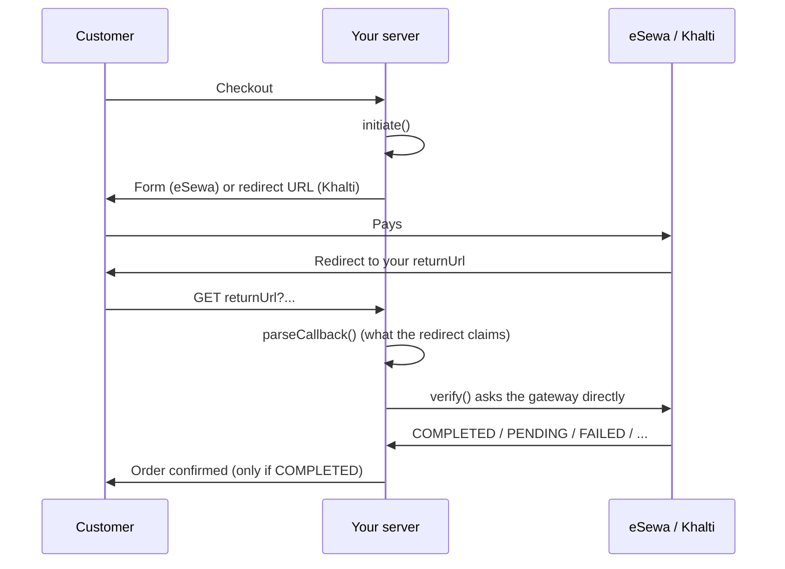

# nepal-pay

[](https://github.com/anishbhattarai-asm/nepal-pay/actions/workflows/ci.yml)
[](https://www.npmjs.com/package/@nepalpay/esewa)
[](https://www.npmjs.com/package/@nepalpay/khalti)
[](LICENSE)

Accept **eSewa** and **Khalti** payments from Node.js with a few lines of TypeScript, without getting
signatures, paisa conversion or payment verification wrong.

* **Zero dependencies.** Only standard `fetch` and Web Crypto.
* **Same API for both gateways:** `initiate()`, `parseCallback()`, `verify()`.
* **Safe by default:** signed eSewa callbacks are checked, every payment is confirmed with the
  gateway, and the paid amount is compared with what you expected.
* **Tested against the real sandboxes**, not only mocks.

> Unofficial. Not affiliated with eSewa or Khalti.

## Contents

* [Packages](#packages)
* [How a payment works](#how-a-payment-works)
* [Quick start: eSewa](#quick-start-esewa)
* [Quick start: Khalti](#quick-start-khalti)
* [Paying again](#paying-again)
* [Rules that keep your money safe](#rules-that-keep-your-money-safe)
* [API reference](#api-reference)
* [Testing in the sandbox](#testing-in-the-sandbox)
* [Gateway quirks handled for you](#gateway-quirks-handled-for-you)
* [Development](#development)

## Packages

| Package | Gateway | Install |
|-|-|-|
| [`@nepalpay/esewa`](https://www.npmjs.com/package/@nepalpay/esewa) | eSewa ePay v2 | `npm i @nepalpay/esewa` |
| [`@nepalpay/khalti`](https://www.npmjs.com/package/@nepalpay/khalti) | Khalti ePayment (KPG-2) | `npm i @nepalpay/khalti` |
| [`@nepalpay/core`](https://www.npmjs.com/package/@nepalpay/core) | Shared types and errors | installed automatically |

Install only the gateway you use. Requires **Node.js 22 or newer** (use a patched release); tested
on Node.js 22, 24 and 26. Ships ESM, CommonJS and TypeScript types.

## How a payment works

Both gateways follow the same three steps. The redirect back to your site is only a claim: the
payment is real once `verify()` says so.



## Quick start: eSewa

In the examples, `db` stands for your own database code.

```ts
import express from 'express';
import escapeHtml from 'escape-html'; // npm i escape-html
import { createEsewa, paymentAttemptId } from '@nepalpay/esewa';

const esewa = createEsewa({
  environment: 'sandbox', // 'production' for real money; there is no default
  productCode: process.env.ESEWA_PRODUCT_CODE!, // EPAYTEST in sandbox
  secretKey: process.env.ESEWA_SECRET_KEY!, // keep it on the server
});

const app = express();

// 1. Start a payment attempt: eSewa needs a signed form POSTed from the customer's browser.
app.post('/orders/:id/pay/esewa', async (req, res) => {
  const order = await db.orders.find(req.params.id); // amount in rupees, from your own data
  const attemptId = paymentAttemptId(order.id); // a new id for every attempt, see "Paying again"
  await db.attempts.create({ id: attemptId, orderId: order.id, gateway: 'esewa' });
  const form = await esewa.initiate({
    amount: order.amount,
    orderId: attemptId,
    returnUrl: 'https://shop.example/esewa/callback',
    failureUrl: `https://shop.example/esewa/failure/${attemptId}`,
  });
  if (form.type !== 'form') throw new Error('unexpected');
  const inputs = Object.entries(form.fields)
    .map(([name, value]) => `<input type="hidden" name="${escapeHtml(name)}" value="${escapeHtml(value)}">`)
    .join('');
  res.send(`<form id="pay" method="post" action="${escapeHtml(form.action)}">${inputs}</form>
            <script>document.getElementById('pay').submit()</script>`);
});

// 2. eSewa sends the customer back with ?data=<base64>.
app.get('/esewa/callback', async (req, res) => {
  const claim = await esewa.parseCallback({ data: String(req.query.data) }); // checks the signature
  const attempt = await db.attempts.find(claim.orderId!); // the attempt id you sent
  const order = await db.orders.find(attempt.orderId);

  // 3. Ask eSewa, using the amount from YOUR records.
  const result = await esewa.verify({ orderId: attempt.id, amount: order.amount });
  if (result.status === 'COMPLETED') {
    await db.orders.markPaid(order.id, result.transactionId);
    return res.send('Thank you, payment received.');
  }
  res.send(`Payment not completed (${result.status}).`);
});
```

## Quick start: Khalti

```ts
import express from 'express';
import { createKhalti, paymentAttemptId } from '@nepalpay/khalti';

const khalti = createKhalti({
  environment: 'sandbox', // 'production' for real money; there is no default
  secretKey: process.env.KHALTI_SECRET_KEY!, // from test-admin.khalti.com in sandbox
  websiteUrl: 'https://shop.example',
});

const app = express();

// 1. Start a payment attempt: Khalti returns a URL to send the customer to.
app.post('/orders/:id/pay/khalti', async (req, res) => {
  const order = await db.orders.find(req.params.id); // rupees; Khalti's minimum is Rs 10
  const start = await khalti.initiate({
    amount: order.amount, // converted to paisa for you
    orderId: paymentAttemptId(order.id), // a new id for every attempt, see "Paying again"
    returnUrl: 'https://shop.example/khalti/callback',
    productName: 'Momo platter',
    customer: { name: 'Sita', phone: '9800000001' }, // optional
  });
  if (start.type !== 'redirect') throw new Error('unexpected');
  await db.attempts.create({ id: start.reference, orderId: order.id, gateway: 'khalti' }); // the pidx
  res.redirect(303, start.url);
});

// 2. Khalti sends the customer back with ?pidx=...&status=... (not signed).
app.get('/khalti/callback', async (req, res) => {
  const claim = await khalti.parseCallback(req.query);
  const attempt = await db.attempts.find(claim.reference); // by the pidx you stored, never by URL order id
  const order = await db.orders.find(attempt.orderId);

  // 3. Ask Khalti, using the amount from YOUR records.
  const result = await khalti.verify({ pidx: claim.reference, expectedAmount: order.amount });
  if (result.status === 'COMPLETED') {
    await db.orders.markPaid(order.id, result.transactionId);
    return res.send('Thank you, payment received.');
  }
  res.send(`Payment not completed (${result.status}).`);
});
```

A complete working app with both gateways is in [`examples/express-demo`](examples/express-demo).

## Paying again

Customers abandon payments, run out of balance, or press back, and your site offers "Pay again". Do
it with **one order and many payment attempts**:

1. **Give every attempt its own id** with `paymentAttemptId(order.id)` (the order id plus 8 random
   characters). eSewa refuses a `transaction_uuid` it has seen before with HTTP 400
   `Duplicate transaction UUID.`, even when the first attempt was abandoned or used another amount.
2. **Before starting a new attempt, `verify()` the earlier ones.** An abandoned eSewa attempt stays
   `PENDING`, and an open Khalti payment page can still be paid until it expires. If one of them
   completed in the meantime, the order is already paid: do not charge again.
3. **Match each callback to its attempt** (eSewa `transaction_uuid`, Khalti `pidx`), then to its order.
4. **If two attempts both complete, flag the order and refund one.** It can happen when a customer
   pays an old page and a new one; the demo marks such orders `PAID_TWICE`.

```ts
async function payAgain(order) {
  for (const attempt of await db.attempts.forOrder(order.id)) {
    if (attempt.status === 'COMPLETED') continue;
    const result = attempt.gateway === 'esewa'
      ? await esewa.verify({ orderId: attempt.id, amount: order.amount })
      : await khalti.verify({ pidx: attempt.id, expectedAmount: order.amount });
    await db.attempts.update(attempt.id, { status: result.status });
    if (result.status === 'COMPLETED') return markPaid(order, attempt); // paid late: no new charge
  }
  return startAttempt(order); // a new paymentAttemptId(order.id)
}
```

## Rules that keep your money safe

1. **Fulfil an order only when `verify()` returns `COMPLETED`.** The redirect URL can be typed by
   anyone; `parseCallback()` only tells you what it claims.
2. **Pass the amount from your database to `verify()`.** A completed payment for a different amount
   throws `AMOUNT_MISMATCH` instead of passing.
3. **Khalti: find the order by the pidx you stored at `initiate()`.** Khalti's redirect is unsigned
   and its lookup API does not return your order id, so `purchase_order_id` from the URL proves nothing.
4. **Use a new `paymentAttemptId()` for every attempt** and check earlier attempts before charging
   again (see [Paying again](#paying-again)).
5. **Keep secret keys on the server.** Both clients refuse to start in a browser page or worker. That
   check catches mistakes; it cannot protect a key that was already shipped to a browser.
6. **Set `environment` explicitly.** There is no default, so test keys never meet real money by
   accident. In production, every callback and website URL must be `https`.
7. **Make fulfilment idempotent.** Customers refresh and gateways retry; marking an order paid twice
   should be harmless.

## API reference

### Creating a client

```ts
createEsewa({ environment, productCode, secretKey, fetch?, timeoutMs? })
createKhalti({ environment, secretKey, websiteUrl, fetch?, timeoutMs? })
```

| Option | Meaning |
|-|-|
| `environment` | `'sandbox'` or `'production'`. Required. |
| `productCode` | eSewa merchant code (`EPAYTEST` in sandbox). |
| `secretKey` | eSewa HMAC secret, or Khalti secret key. |
| `websiteUrl` | Your site's URL, sent to Khalti. |
| `fetch` | Custom fetch for proxies, logging or tests. Defaults to the global `fetch`. |
| `timeoutMs` | Request timeout. Default `15000`. |

### Methods

| Method | eSewa | Khalti |
|-|-|-|
| `initiate(input)` | `{ type: 'form', action, fields, reference }` | `{ type: 'redirect', url, reference, raw }` |
| `parseCallback(input)` | `{ data }` from the query string | `req.query`, `URLSearchParams`, a query string or the full URL |
| `verify(input)` | `{ orderId, amount }` | `{ pidx, expectedAmount }` |

`initiate()` takes `{ amount, orderId, returnUrl, failureUrl?, productName?, customer? }`. `orderId` is
the id of **this attempt**: use `paymentAttemptId(order.id)`, exported by both packages. Amounts are
always **rupees** (up to 2 decimals); conversion to paisa happens inside.

`verify()` returns `{ status, amount, orderId?, transactionId?, raw }`.
`parseCallback()` returns `{ reference, orderId?, transactionId?, claimedStatus, amount?, signatureValid, raw }`,
where `signatureValid` is `true` for eSewa (forged callbacks throw) and `null` for Khalti (not signed).

### Statuses

| Status | eSewa | Khalti |
|-|-|-|
| `COMPLETED` | COMPLETE | Completed |
| `PENDING` | PENDING, AMBIGUOUS | Pending, Initiated |
| `REFUNDED` | FULL_REFUND, PARTIAL_REFUND | Refunded, Partially Refunded |
| `CANCELED` | CANCELED | User canceled |
| `FAILED` | NOT_FOUND, anything else | Expired, anything else |

The gateway's original response is always in `raw`.

### Errors

Every failure is a `PaymentError`. Check `err.code` (works even with two copies of the package):

```ts
import { isPaymentError } from '@nepalpay/esewa';

try {
  await esewa.verify({ orderId, amount });
} catch (err) {
  if (isPaymentError(err) && err.code === 'AMOUNT_MISMATCH') {
    // flag the order for review
  }
  throw err;
}
```

| Code | When |
|-|-|
| `INVALID_CONFIG` | Missing or unknown environment, empty keys, bad `websiteUrl` (must be `https` in production). |
| `INVALID_INPUT` | Bad or too large amount, unsafe order id, relative URL, `http` callback URL in production, unreadable or oversized callback, Khalti under Rs 10. |
| `SIGNATURE_MISMATCH` | eSewa callback not signed with your key, signed without covering status, amount, order and product, or for another product code. |
| `AMOUNT_MISMATCH` | The gateway reports a completed payment for a different amount. |
| `GATEWAY_ERROR` | The gateway returned an error (its message is included), a reply about another payment, a reply over 1 MB, or a Khalti `payment_url` that is not `https`. |
| `NETWORK_ERROR`, `TIMEOUT` | The request did not complete. |
| `BROWSER_ENVIRONMENT` | A client was created in a browser page or worker. |

## Testing in the sandbox

| | eSewa | Khalti |
|-|-|-|
| Merchant keys | product code `EPAYTEST`, secret `8gBm/:&EnhH.1/q` (public test values) | sign up at [test-admin.khalti.com](https://test-admin.khalti.com/#/join/merchant) and use its `live_secret_key` |
| Test customer login | eSewa ID `9806800001`, password `Nepal@123`, token `123456` | Khalti ID `9800000000` to `9800000005`, MPIN `1111`, OTP `987654` |

Run the demo app against the sandboxes:

```sh
git clone https://github.com/anishbhattarai-asm/nepal-pay.git
cd nepal-pay
npm ci
npm run demo   # http://localhost:3000, set KHALTI_SECRET_KEY to enable Khalti
```

## Gateway quirks handled for you

These were checked against the live sandboxes and are covered by tests:

* eSewa signs `total_amount=1000.0` but sends `1000.0` as a JSON number. A plain `JSON.parse` turns it
  into `1000` and every round-amount payment fails its signature check; this library keeps the exact text.
* An eSewa callback lists its own signed fields, and the form your site sends is signed with the same
  key. Callbacks whose signature does not cover status, amount, order and product are rejected, so the
  visible form signature cannot be replayed as a "COMPLETE" callback.
* eSewa's status API answers `NOT_FOUND` when the amount is wrong, so a tampered amount shows as `FAILED`.
* eSewa refuses a `transaction_uuid` it has already seen (`Duplicate transaction UUID.`), even after an
  abandoned attempt, and the abandoned attempt stays `PENDING`. Hence `paymentAttemptId()` and
  [Paying again](#paying-again).
* Khalti's lookup answers `Expired` and `User canceled` with HTTP 400; these become `FAILED` and
  `CANCELED` instead of errors.
* Khalti's status spelling varies ("Partially refunded" and "Partially Refunded"), so it is matched
  case-insensitively.

## Development

```sh
npm ci
npm run check       # build + typecheck + unit tests (what CI runs)
npm run test:live   # hits the real eSewa and Khalti sandboxes
npm run demo        # Express demo on http://localhost:3000
```

`test:live` uses eSewa's public test values. Set `KHALTI_SECRET_KEY` to include Khalti's full flow.
TypeScript is pinned to 5.9 because tsup's declaration build does not work with TypeScript 7.
Design notes are in [ARCHITECTURE.md](ARCHITECTURE.md).

### Releasing

```sh
npm version patch -w @nepalpay/esewa   # bump only the packages that changed
npm run release                        # check, then publish every package whose version is new
```

When core gets a new minor version, update the `@nepalpay/core` range in esewa and khalti too.

## License

[MIT](LICENSE) © Anish Bhattarai
