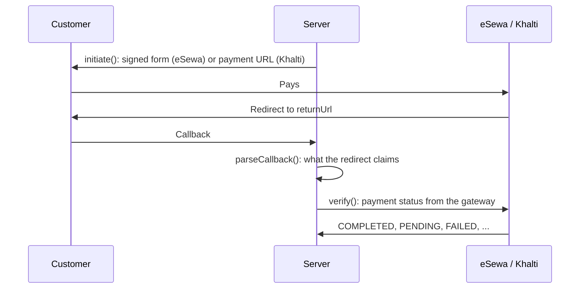

# nepal-pay

[](https://github.com/anishbhattarai-asm/nepal-pay/actions/workflows/ci.yml)
[](https://www.npmjs.com/package/@nepalpay/esewa)
[](https://www.npmjs.com/package/@nepalpay/khalti)
[](LICENSE)

TypeScript SDKs for the eSewa and Khalti payment gateways. Both share one API (`initiate`,
`parseCallback`, `verify`), have no runtime dependencies, and confirm every payment with the gateway
before reporting it as completed.

Unofficial; not affiliated with eSewa or Khalti.

| Package | Gateway |
|-|-|
| [`@nepalpay/esewa`](https://www.npmjs.com/package/@nepalpay/esewa) | eSewa ePay v2 |
| [`@nepalpay/khalti`](https://www.npmjs.com/package/@nepalpay/khalti) | Khalti ePayment (KPG-2) |
| [`@nepalpay/core`](https://www.npmjs.com/package/@nepalpay/core) | Shared types and errors, installed with either gateway |

Node.js 22 or newer. ESM, CommonJS and TypeScript types. Uses only `fetch` and Web Crypto.

## Payment flow



A payment counts as completed only when `verify()` returns `COMPLETED`.

## Usage

`db` stands for the application's own storage, with one record per order and one per payment attempt:

| Record | Fields |
|-|-|
| Order | `id`, `amount` (rupees), `status` (`UNPAID`, `PAID`, `PAID_TWICE`) |
| Attempt | `id` (eSewa `transaction_uuid` or Khalti pidx), `orderId`, `gateway`, `status`, `transactionId` |

### eSewa

```ts
import { createEsewa, paymentAttemptId } from '@nepalpay/esewa';

const esewa = createEsewa({ environment: 'production', productCode, secretKey });

// Start a payment attempt; the browser POSTs form.fields to form.action.
const attemptId = paymentAttemptId(order.id);
await db.attempts.create({ id: attemptId, orderId: order.id });
const form = await esewa.initiate({
  amount: order.amount, // rupees
  orderId: attemptId,
  returnUrl: 'https://shop.example/esewa/callback',
  failureUrl: `https://shop.example/esewa/failure/${attemptId}`,
});

// Callback (?data=...): signature check, then the status from eSewa.
const claim = await esewa.parseCallback({ data: String(req.query.data) });
const attempt = await db.attempts.find(claim.orderId!);
const order = await db.orders.find(attempt.orderId);
const result = await esewa.verify({ orderId: attempt.id, amount: order.amount });
if (result.status === 'COMPLETED') await db.orders.markPaid(order.id, result.transactionId);
```

### Khalti

```ts
import { createKhalti, paymentAttemptId } from '@nepalpay/khalti';

const khalti = createKhalti({ environment: 'production', secretKey, websiteUrl: 'https://shop.example' });

// Start a payment attempt; the customer is redirected to start.url.
const start = await khalti.initiate({
  amount: order.amount, // rupees, minimum 10
  orderId: paymentAttemptId(order.id),
  returnUrl: 'https://shop.example/khalti/callback',
});
await db.attempts.create({ id: start.reference, orderId: order.id }); // reference is the pidx

// Callback (?pidx=...): unsigned, so the attempt is found by the stored pidx.
const claim = await khalti.parseCallback(req.query);
const attempt = await db.attempts.find(claim.reference);
const order = await db.orders.find(attempt.orderId);
const result = await khalti.verify({ pidx: attempt.id, expectedAmount: order.amount });
if (result.status === 'COMPLETED') await db.orders.markPaid(order.id, result.transactionId);
```

Complete apps with both gateways, retries included, are in
[`examples/express-demo`](examples/express-demo) (Express) and
[`examples/nextjs-demo`](examples/nextjs-demo) (Next.js App Router, route handlers and a server
action). Both keep orders in memory and are local sandbox demos, not deployable apps.

## Retries

An order can need several payment attempts (abandoned page, insufficient balance, back button).

- `paymentAttemptId(order.id)` returns a new id per attempt. eSewa rejects any reused
  `transaction_uuid` (`Duplicate transaction UUID.`); Khalti issues a new pidx per attempt.
- An abandoned eSewa attempt stays `PENDING`, and a Khalti payment page stays payable for 30 minutes
  in the sandbox (60 in production by default), so an earlier attempt can still complete after a new
  one starts.
- The demo therefore re-verifies earlier attempts before starting a new one, matches each callback to
  its attempt, and marks an order `PAID_TWICE` when two attempts complete, for a refund.
- Two requests for one order can arrive together (double click, two tabs). The demo runs one payment
  start per order at a time and caps attempts per order (`maxAttempts`, default 10). With a database,
  the same guard is a row lock (`SELECT ... FOR UPDATE`) or a conditional update on the order.

## Gateway outages

Neither gateway publishes a health endpoint, so an outage shows up as an error from `verify()` or
Khalti's `initiate()`. `error.retryable` marks failures that may clear on their own:

| Error | `retryable` | Cause |
|-|-|-|
| `NETWORK_ERROR` | true | Gateway unreachable, or the connection broke during the reply |
| `TIMEOUT` | true | No complete reply within `timeoutMs` (default 15000) |
| `GATEWAY_ERROR`, HTTP 429 or 5xx | true | Rate limit or maintenance; `details.status` holds the HTTP status |
| Any other error | false | Input, configuration, signature or amount problem; a repeat gives the same result |

`retryable` means the failure is transient, not that the request had no effect:

| Call | After a retryable error |
|-|-|
| `verify()` | Read only, so repeating it is safe. The payment is unknown, not failed: the customer may already have paid. The attempt keeps its last status and is verified again on the next callback, status check or scheduled job. |
| Khalti `initiate()` | Khalti may already have created the payment. Its pidx and payment URL were in the lost reply, so the customer never reaches that page and it expires unpaid. Khalti offers no idempotency key and no lookup by `purchase_order_id`, so that pidx cannot be recovered; a new attempt with a new `paymentAttemptId()` does not risk a double charge. |
| eSewa `initiate()` | Signs the form locally and sends no request, so it cannot fail this way. |

The library never retries by itself. The `fetch` option accepts a wrapper for retries, circuit
breaking or logging; a retrying wrapper repeats only the status and lookup requests, never Khalti's
`/epayment/initiate/`. The demo answers 503 for retryable errors, leaves the order neither paid nor
failed, and logs the attempt id of a Khalti start that got no reply.

## Security model

Enforced by the library:

| Area | Behaviour |
|-|-|
| Payment status | `verify()` asks the gateway and returns `COMPLETED` only from the gateway's reply |
| Amount | A completed payment for a different amount throws `AMOUNT_MISMATCH` |
| eSewa callbacks | HMAC-SHA256 checked with a constant-time compare; the signature must cover status, amount, transaction id and product code, and the product code must match the client |
| Gateway replies | Must name the same transaction (eSewa) or pidx (Khalti) and product code, with a whole-paisa amount; replies over 1 MB are refused |
| Callback input | eSewa data over 4 KB is refused; Khalti amounts must be whole paisa |
| URLs | Callback and website URLs must be `https` in production; Khalti `payment_url` must be `https` |
| Configuration | `environment` is required; there is no default |
| Runtime | Clients refuse to start in a browser page or worker (misuse detection, not a boundary) |

Vulnerability reports: see [SECURITY.md](SECURITY.md).

## Production checklist

| Area | Library | Application |
|-|-|-|
| Secret keys | Refuses to run in a browser | Keeps keys in environment variables or a secret store, separate for sandbox and production |
| HTTPS | Requires `https` callback and website URLs in production | Serves the callback routes over HTTPS |
| Payment status | `verify()` asks the gateway and checks the amount | Marks an order paid only from `verify()`, never from the redirect |
| Attempts | `paymentAttemptId()` gives each attempt its own id | Stores each attempt before redirecting and matches callbacks to it |
| Concurrency | Application only | Starts one attempt per order at a time (row lock or conditional update) |
| Fulfilment | Application only | Fulfils each order once, even when a callback arrives twice |
| Outages | Typed errors with `retryable` | Keeps attempts on errors and verifies them again later |
| Reconciliation | Application only | Re-verifies unfinished attempts on a schedule, catching customers who never return to the site |
| Refunds | Application only | Refunds `PAID_TWICE` orders and returns through the gateway's merchant portal |
| Abuse | Per-order attempt cap in the demo only | Rate limits payment starts per IP or account, keeps attempt limits in the database, and watches for unusual numbers of starts |

## API

| Method | eSewa | Khalti |
|-|-|-|
| `initiate()` | `{ amount, orderId, returnUrl, failureUrl? }` returns `{ type: 'form', action, fields, reference }` | `{ amount, orderId, returnUrl, productName?, customer? }` returns `{ type: 'redirect', url, reference, raw }` |
| `parseCallback()` | `{ data }` | `req.query`, `URLSearchParams`, query string or URL |
| `verify()` | `{ orderId, amount }` | `{ pidx, expectedAmount }` |

Client options: `environment`, gateway keys (`productCode` and `secretKey`, or `secretKey` and
`websiteUrl`), and optional `fetch` and `timeoutMs` (default 15000). Amounts are rupees with up to
2 decimals.

| `status` | eSewa | Khalti |
|-|-|-|
| `COMPLETED` | COMPLETE | Completed |
| `PENDING` | PENDING, AMBIGUOUS | Pending, Initiated |
| `REFUNDED` | FULL_REFUND, PARTIAL_REFUND | Refunded, Partially Refunded |
| `CANCELED` | CANCELED | User canceled |
| `FAILED` | NOT_FOUND, other | Expired, other |

Results include `raw`, the gateway's reply as received (Khalti amounts in paisa). Errors are
`PaymentError` instances with a `code` and `retryable`; `isPaymentError()` works across package copies.

| Code | Meaning |
|-|-|
| `INVALID_CONFIG` | Missing or invalid client options |
| `INVALID_INPUT` | Invalid amount, id, URL or callback |
| `SIGNATURE_MISMATCH` | eSewa callback not signed by this merchant, or signed too narrowly |
| `AMOUNT_MISMATCH` | Completed payment for a different amount |
| `GATEWAY_ERROR` | Gateway error reply, or a reply about another payment |
| `NETWORK_ERROR`, `TIMEOUT` | Request did not complete |
| `BROWSER_ENVIRONMENT` | Client created in a browser |

## Testing

| Suite | Command | Covers |
|-|-|-|
| Unit (302 tests) | `npm run check` | Signing and signature coverage, every status mapping, amount and paisa handling, URL and size limits, error mapping including stalled and broken replies, and in both demos: retries, double payment, simultaneous checkout requests, outages, forged callbacks and a Khalti start whose reply was lost |
| Live sandbox | `npm run test:live` | Signed form accepted by eSewa, tampered signature rejected (`ES104`), reused id rejected, status lookups, Khalti initiate and lookup (with `KHALTI_SECRET_KEY`) |
| CI | GitHub Actions | Build (including the Next.js demo), typecheck and unit tests on Node.js 22, 24 and 26 for every push |

Unit tests use fixtures recorded from the gateways: eSewa's documented callback, a real eSewa
sandbox callback from a completed payment, and a completed Khalti sandbox payment. Full sandbox
payments (login, payment, callback, status check) went through both demos on 2026-11-02: eSewa
through the Express demo, eSewa and Khalti through the Next.js demo's production build.

## Development

```sh
npm ci
npm run check        # build, typecheck, unit tests
npm run test:live    # real eSewa and Khalti sandboxes
npm run demo         # Express demo on http://localhost:3000; KHALTI_SECRET_KEY enables Khalti
npm run demo:next    # Next.js demo on http://localhost:3000
```

Releases go through the **Release** workflow (Actions tab, Run workflow). It runs the full check and
stages every package whose version is not on npm yet, using npm trusted publishing with provenance.
A staged version goes live after approval with 2FA on npmjs.com (Staged Packages) or with
`npm stage approve`.

Sandbox credentials: eSewa uses the public product code `EPAYTEST` and secret `8gBm/:&EnhH.1/q`;
Khalti keys come from [test-admin.khalti.com](https://test-admin.khalti.com/#/join/merchant).
Customer logins used for the recorded payments: eSewa ID `9711111111`, MPIN `1122`; Khalti ID
`9800000001`, MPIN `1111`.
TypeScript is pinned to 5.9 because tsup's declaration build does not support TypeScript 7.
Design notes: [ARCHITECTURE.md](ARCHITECTURE.md).

## License

[MIT](LICENSE)
